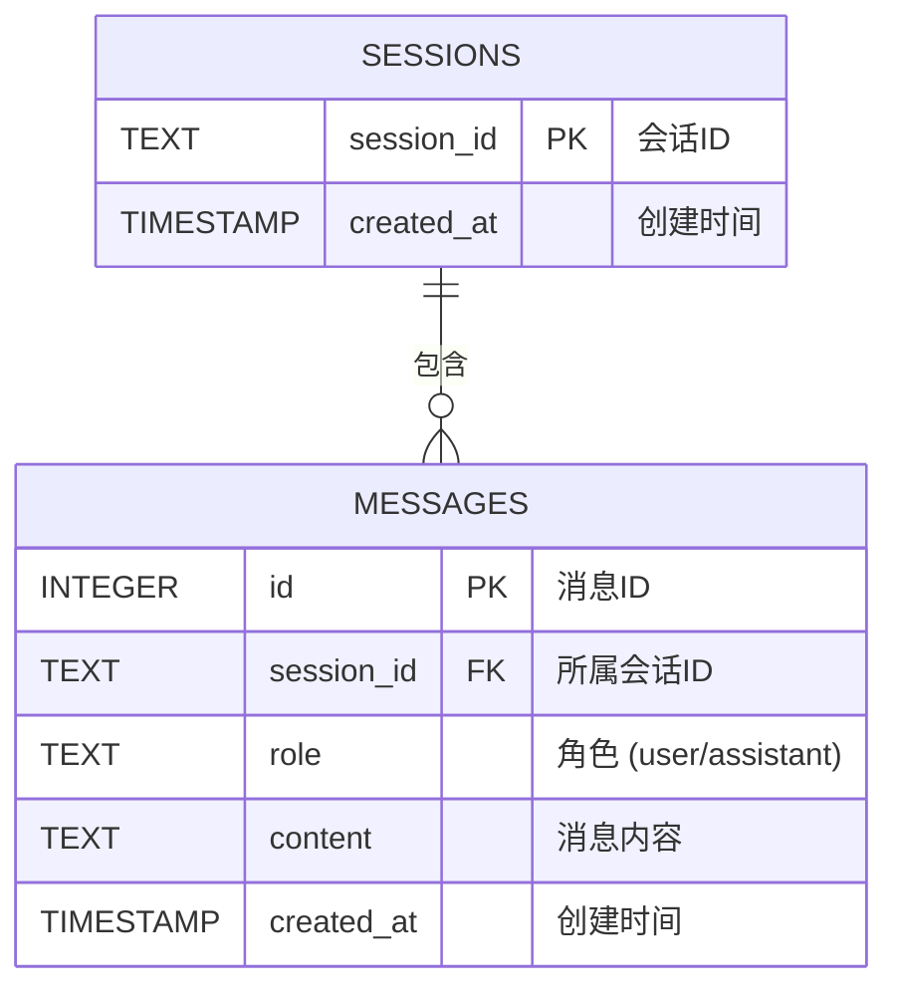

# Chatbot FastAPI 服务

这是一个基于 FastAPI 和 OpenAI 兼容接口（如 DeepSeek）的对话机器人。支持通过 HTTP 进行普通对话、流式输出、会话管理以及英语纠错学习功能。

**（本次更新）**：新增了纯 HTML 网页聊天界面，并将会话数据从内存迁移至 **SQLite 数据库**，实现数据持久化。

## 环境准备与启动

1. 安装依赖：
   ```bash
   uv sync
   ```

2. 配置环境变量：
   - 复制 `.env.example` 文件并重命名为 `.env`（注意前面有个点）。
   - 在 `.env` 中填入你真实的 API Key：
     ```env
     CHATBOT_API_KEY=sk-你的真实api_key
     CHATBOT_BASE_URL=https://api.deepseek.com
     CHATBOT_MODEL=deepseek-chat
     CHATBOT_TEMPERATURE=0.7
     ```

3. 启动服务：
   ```bash
   uv run uvicorn app.main:app --reload
   ```

4. **访问网页聊天界面**：启动服务后，打开浏览器访问 [http://127.0.0.1:8000](http://127.0.0.1:8000)，即可使用纯 HTML 聊天页面。

5. **查看 API 文档**：如果需要调试接口，访问 [http://127.0.0.1:8000/docs](http://127.0.0.1:8000/docs)。
---

## 主要接口说明

### 1. 普通对话 `POST /chat`
传入会话 ID 和消息，返回模型的完整回复。相同 ID 的后续请求会携带之前的对话历史。

**请求示例：**
```bash
curl -X POST http://127.0.0.1:8000/chat \
  -H "Content-Type: application/json" \
  -d '{"session_id":"u1","message":"你好，请记住我叫张三"}'
```

### 2. 流式对话 `POST /chat/stream`
请求体与普通对话相同。使用 `StreamingResponse` 边生成边返回，响应结束后会自动将完整回复保存到历史记录中。

**请求示例：**
```bash
curl -N -X POST http://127.0.0.1:8000/chat/stream \
  -H "Content-Type: application/json" \
  -d '{"session_id":"u1","message":"请写一首关于夏天的诗"}'
```

### 3. 会话管理
- **查看所有会话 ID**：`GET /sessions`
- **查看指定会话的消息记录**：`GET /sessions/{session_id}/messages`
- **清空（删除）指定会话**：`DELETE /sessions/{session_id}`

### 4. 学习功能：英语纠错 `POST /study/correct`
分析用户输入的英文，指出语法或用词错误，并给出修改建议。作为独立的 API 工具提供。

**请求示例：**
```bash
curl -X POST http://127.0.0.1:8000/study/correct \
  -H "Content-Type: application/json" \
  -d '{"text":"He go to school yesterday."}'
```

### 5. 网页聊天界面 `GET /`
由 FastAPI 的 `StaticFiles` 托管在根路径 `/`。页面通过原生 JavaScript 的 `fetch` 调用上述接口，实现消息发送、历史加载、会话切换与清空功能。


## 单元测试

本项目包含 3 组离线单元测试。测试过程通过 mock 模型客户端实现，**不需要联网，也不需要真实 API Key**。数据库测试使用临时的 SQLite 内存库或临时文件，**不读取本地 `.env` 也不污染真实 `chat.db`**。

运行测试：
```bash
uv run pytest tests/ -v
```


## 数据库设计 (ER 图)

本项目使用 SQLite 存储数据，包含 `sessions`（会话表）和 `messages`（消息表），两者通过外键关联，并级联删除。

